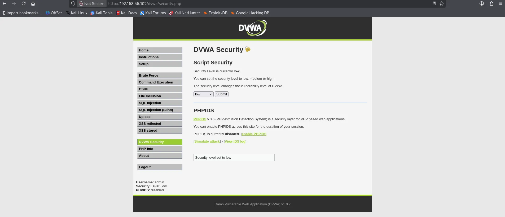
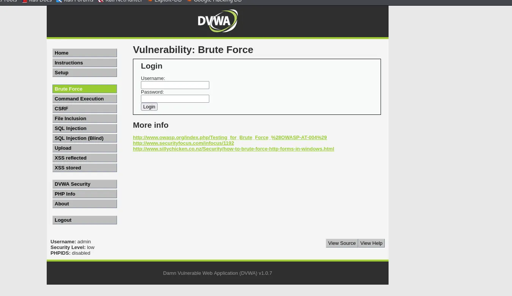
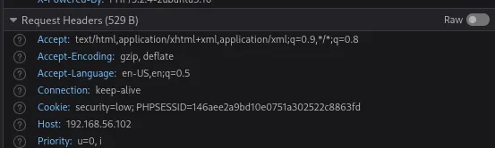
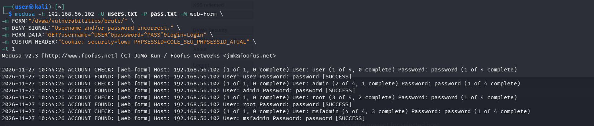

# Cenário 2 — Brute Force em formulário Web (DVWA)

## 1. Objetivo

Simular um teste de força bruta contra um formulário de autenticação web utilizando Kali Linux e Medusa, em um ambiente virtual controlado.

O objetivo foi observar o funcionamento do módulo `web-form` e analisar suas limitações durante a identificação de credenciais.

## 2. Ambiente utilizado

- **Sistema atacante:** Kali Linux
- **Máquina-alvo:** Metasploitable 2
- **Aplicação:** Damn Vulnerable Web Application (DVWA)
- **Endereço IP:** `192.168.56.102`
- **Ferramenta:** Medusa 2.3
- **Módulo utilizado:** `web-form`
- **Nível de segurança do DVWA:** Low
  
## 3. Configuração do DVWA

Após acessar a aplicação, foi configurado o nível de segurança como **Low**.

**Evidência da configuração do DVWA:**

Em seguida, foi acessada a funcionalidade **Brute Force**, que disponibiliza um formulário com os campos:

- Username
- Password

**Evidência do formulário Brute Force:**

Também foi analisado o código-fonte da funcionalidade para identificar os parâmetros utilizados no processo de autenticação.

## 4. Análise da requisição HTTP

Foi utilizado o painel de desenvolvedor do navegador, na aba Network, para observar as requisições realizadas durante uma tentativa de autenticação.

A análise permitiu identificar:

- Método HTTP utilizado: GET.
- Caminho da funcionalidade: `/dvwa/vulnerabilities/brute/`.
- Parâmetros enviados: `username`, `password` e `Login`.
- Utilização de cookies de sessão.

Essas informações foram utilizadas para configurar o módulo `web-form` do Medusa.

**Evidência:**

## 5. Configuração do formulário

Com as informações identificadas na análise HTTP, foram definidos os parâmetros necessários para a execução do teste:

- Caminho do formulário.
- Parâmetros de usuário e senha.
- Mensagem apresentada quando a autenticação falha.
- Cookie de sessão utilizado pelo DVWA.

O objetivo foi permitir que o Medusa reproduzisse as tentativas de autenticação realizadas pelo formulário web.

## 6. Execução do Medusa

Foi utilizado o módulo `web-form` para realizar as tentativas automatizadas com as listas de usuários e senhas preparadas para o laboratório.

A execução foi realizada com o comando configurado para o formulário DVWA, utilizando o endereço IP da máquina-alvo e os parâmetros identificados anteriormente.

## 7. Resultado obtido

Durante a execução, o Medusa apresentou mensagens `ACCOUNT FOUND` e classificou algumas combinações como `SUCCESS`.

Entretanto, foram observados resultados positivos para diferentes combinações, inclusive combinações que não haviam sido confirmadas manualmente.

Isso indicou que a configuração do critério de identificação de sucesso não estava distinguindo corretamente as respostas de autenticação.

Portanto, os resultados foram considerados **inconclusivos**, não sendo possível afirmar que todas as combinações identificadas correspondiam a credenciais válidas.

**Evidência:**

## 8. Medidas defensivas

Algumas medidas que ajudam a reduzir o risco de ataques de força bruta em aplicações web são:

- Implementar limites de tentativas de autenticação.
- Utilizar mecanismos de bloqueio temporário de contas.
- Adotar senhas fortes e exclusivas.
- Implementar autenticação multifator (MFA).
- Monitorar tentativas de autenticação suspeitas.
- Utilizar mecanismos de CAPTCHA quando apropriado.

## 9. Conclusão

O experimento permitiu compreender o funcionamento do módulo `web-form` do Medusa e sua utilização em testes de autenticação web.

Também foi possível identificar uma limitação na interpretação das respostas HTTP, que ocasionou resultados inconclusivos.

A atividade reforçou a importância de não considerar automaticamente os resultados de ferramentas de segurança como evidências definitivas, sendo necessária a validação das informações obtidas.

## 10. Evidências

As capturas de tela deste cenário estão organizadas no diretório:

`screenshots/web-dvwa/`

As evidências incluem:

1. Configuração do nível de segurança do DVWA.
2. Formulário de autenticação.
3. Análise da requisição HTTP.
4. Execução do Medusa e resultados apresentados.

## 11. Aviso de segurança

Este laboratório foi realizado exclusivamente em ambiente virtual controlado, com finalidade educacional.

As técnicas apresentadas devem ser utilizadas somente em sistemas próprios ou com autorização explícita.
